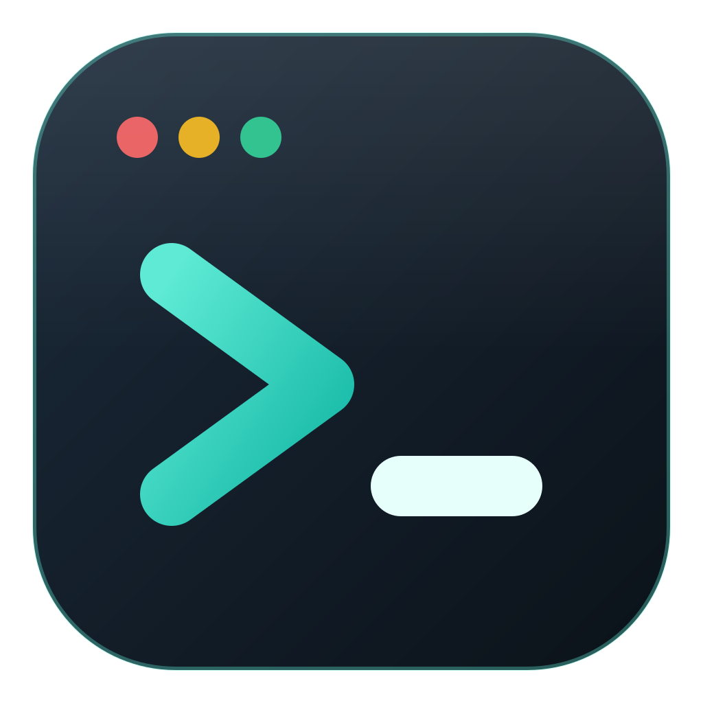
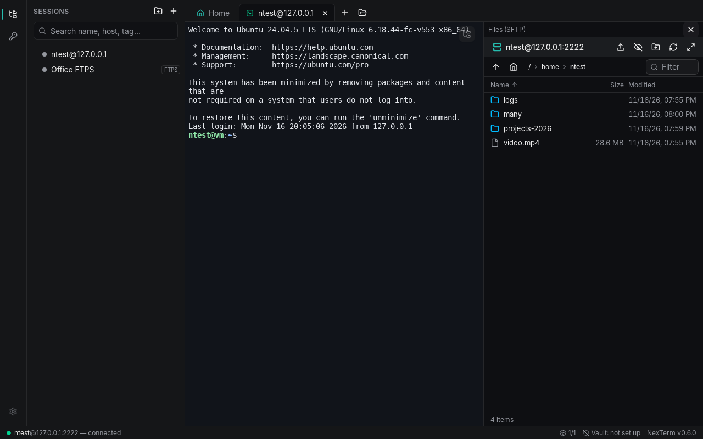
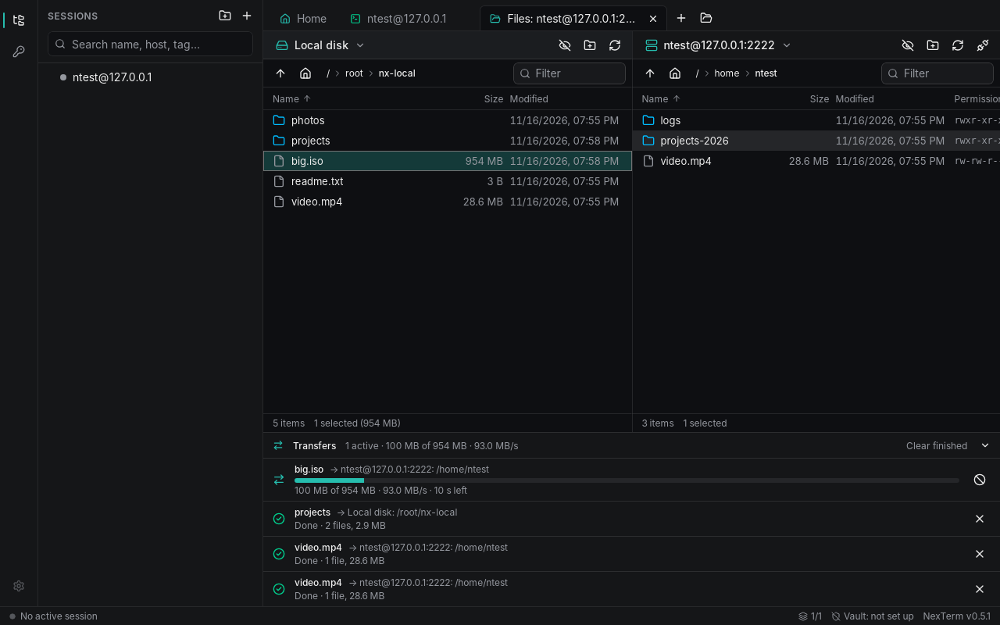
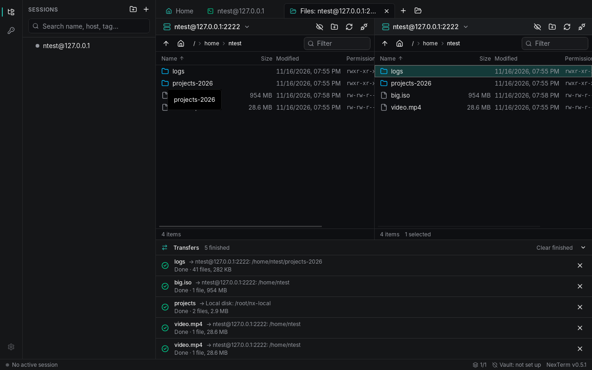
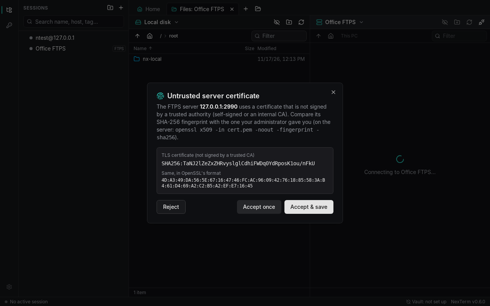

<div align="center">



# NexTerm

**A security-first, open-source SSH, SFTP and FTP client for Windows.**<br />
A modern alternative to MobaXterm: tabs, a session library, an encrypted credential vault
and a WinSCP-style file manager, in one fast native app.

[](https://github.com/AramEvin/nexterm/actions/workflows/ci.yml)
[](https://github.com/AramEvin/nexterm/actions/workflows/codeql.yml)
[](https://scorecard.dev/viewer/?uri=github.com/AramEvin/nexterm)
[](https://github.com/AramEvin/nexterm/releases)
[](LICENSE)


[Download](https://github.com/AramEvin/nexterm/releases) ·
[Features](#features) ·
[Security](#security-model) ·
[Roadmap](docs/ROADMAP.md) ·
[Contributing](CONTRIBUTING.md)



</div>

> [!NOTE]
> NexTerm is in active development (**v0.6, pre-1.0**). Each phase of the
> [roadmap](docs/ROADMAP.md) ships as a tested Windows installer. Expect rough edges
> and please [report them](https://github.com/AramEvin/nexterm/issues/new/choose).

## Why NexTerm

- **Secure by default.** Host keys and certificates are verified, and a changed one
  blocks the connection. Passwords and keys live only in an encrypted vault, never in
  the session database or the logs.
- **Everything in one place.** Terminals, saved sessions, file transfer between your PC
  and servers (or **server to server**), and remote file editing.
- **Fast and light.** A native Rust core with a small web UI (Tauri), so no Electron
  runtime. Folders with 10,000+ files and libraries with 500+ sessions stay responsive.
- **Free and open.** Apache-2.0, no telemetry, no account, no cloud.

## Features

### Terminal and sessions

- Tabbed SSH terminal (xterm.js with WebGL): 256 colours, UTF-8, full-screen apps
  (`htop`, `vim`, `mc`); each tab is isolated, so one crashing never affects the others
- Session library: nested folders, tags, colours, notes, favourites, drag & drop, and
  instant search (`tag:prod`)
- Reconnect and duplicate tabs without retyping the password
- Login with a password, private key (OpenSSH, PEM, PuTTY `.ppk`), Windows OpenSSH agent /
  Pageant, or keyboard-interactive (2FA / OTP)

### File manager

| Two panes, any two places                                                          | Server to server                                                                  |
| ---------------------------------------------------------------------------------- | --------------------------------------------------------------------------------- |
|  |  |

- **SFTP, FTP and FTPS**: local ↔ remote and remote ↔ remote (relayed through your PC)
- Transfer queue with progress, speed, ETA, cancel and retry; streams files of any size
- Drag & drop between panes or from Windows Explorer; name-clash dialog (overwrite / skip /
  keep both); keeps modification times
- Rename, new folder, delete, permissions (chmod), filter, hidden files, sortable columns,
  full keyboard control (F2, F4, F5, F7, Del)
- **SFTP panel next to every terminal**, using the same login
- **Edit remote files in Notepad**: every save is uploaded back to the server

### Credential vault

- Argon2id (64 MiB, t=3) + XChaCha20-Poly1305, with a per-credential key wrap
- Unlock screen, auto-lock, optional "remember on this device" (Windows Credential Manager)
- Reusable credentials, including a default credential per folder

## Security model

| Threat                          | What NexTerm does                                                                                           |
| ------------------------------- | ----------------------------------------------------------------------------------------------------------- |
| Man-in-the-middle on SSH        | Trust on first use with a fingerprint prompt; a **changed host key blocks** the connection (no override)    |
| Man-in-the-middle on FTPS       | CA-verified certificates, or a pinned fingerprint you accepted; a changed certificate blocks the connection |
| Stolen session database or logs | Secrets only exist encrypted in the vault; automated tests grep the DB files and logs for secrets           |
| Malicious server file names     | Names like `..\..\x`, `C:\evil` or `CON` can't escape the download folder; symlinks are never followed      |
| FTP command injection           | Paths, user names and passwords containing CR/LF are refused                                                |
| Compromised web UI              | Strict CSP, deny-by-default IPC permissions, no shell plugin; every command is validated in Rust            |
| Supply chain                    | `cargo audit` and `npm audit` in CI, Dependabot, CodeQL, OpenSSF Scorecard, release build provenance        |

<details>
<summary>Screenshot: certificate prompt for a self-signed FTPS server</summary>



</details>

Full design and threat model: **[docs/SECURITY.md](docs/SECURITY.md)**. To report a
vulnerability, see **[SECURITY.md](SECURITY.md)** (please don't open a public issue).

## Install

1. Download `NexTerm_<version>_x64-setup.exe` from the
   [latest release](https://github.com/AramEvin/nexterm/releases).
2. Optional: check the file against `SHA256SUMS.txt` from the same release:
   ```powershell
   Get-FileHash .\NexTerm_0.6.1_x64-setup.exe
   ```
   You can also verify the build provenance with
   `gh attestation verify <file> --repo AramEvin/nexterm`.
3. Run the installer. It's not code-signed yet, so Windows SmartScreen will warn you:
   choose **More info → Run anyway**. Signing is planned before 1.0.

Requirements: Windows 10 (1809+) or 11, x64. WebView2 is installed automatically if
it's missing.

## Build from source

Requires Node.js LTS, Rust (stable) and the Tauri prerequisites. Full setup guide:
[docs/SETUP-WINDOWS.md](docs/SETUP-WINDOWS.md).

```powershell
git clone https://github.com/AramEvin/nexterm.git
cd nexterm
npm ci
npm run tauri dev        # run with hot reload
npx tauri build          # MSI + NSIS installers in src-tauri/target/release/bundle/
```

| Command                                                                  | What it does              |
| ------------------------------------------------------------------------ | ------------------------- |
| `npm run lint` · `npm run typecheck` · `npm test` · `npm run format`     | Frontend checks and tests |
| `cd src-tauri && cargo fmt && cargo clippy --all-targets -- -D warnings` | Rust lint                 |
| `cd src-tauri && cargo test`                                             | Rust unit tests           |

Integration tests run against real OpenSSH and FTP/FTPS servers; see
[CONTRIBUTING.md](CONTRIBUTING.md#integration-tests).

## Tech stack

**Core:** Rust · Tauri 2 · tokio · russh / russh-sftp · suppaftp + rustls · rusqlite ·
argon2 · chacha20poly1305 · keyring<br />
**UI:** React · TypeScript (strict) · Vite · xterm.js · Tailwind CSS · shadcn/ui · zustand

Architecture overview: [docs/ARCHITECTURE.md](docs/ARCHITECTURE.md) ·
decision records: [docs/adr/](docs/adr/)

## Roadmap

| Version | Phase                                                                | Status  |
| ------- | -------------------------------------------------------------------- | ------- |
| 0.1–0.5 | Terminal, tabs, session library, vault, key/agent/2FA login          | ✅ Done |
| 0.6     | File manager: SFTP, FTP/FTPS, server-to-server, side panel, editing  | ✅ Done |
| 0.7     | Split panes, live CPU/RAM/disk bar, multi-exec, paste safety check   | 🔜 Next |
| 0.8     | Jump hosts (ProxyJump), import from MobaXterm and PuTTY              |         |
| 0.9     | Telnet, serial (COM), local PowerShell / CMD / WSL                   |         |
| 0.10    | VNC and RDP                                                          |         |
| 1.0     | Settings and themes, command palette, signed installers, auto-update |         |

Details: [docs/ROADMAP.md](docs/ROADMAP.md) · release notes: [CHANGELOG.md](CHANGELOG.md)

## Contributing

Bug reports, ideas and pull requests are welcome. Please read
[CONTRIBUTING.md](CONTRIBUTING.md) and the [Code of Conduct](CODE_OF_CONDUCT.md) first.

## License

Copyright 2026 NexTerm contributors. Licensed under the
[Apache License, Version 2.0](LICENSE).
